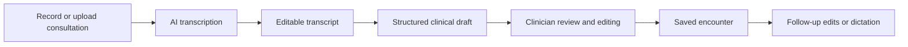
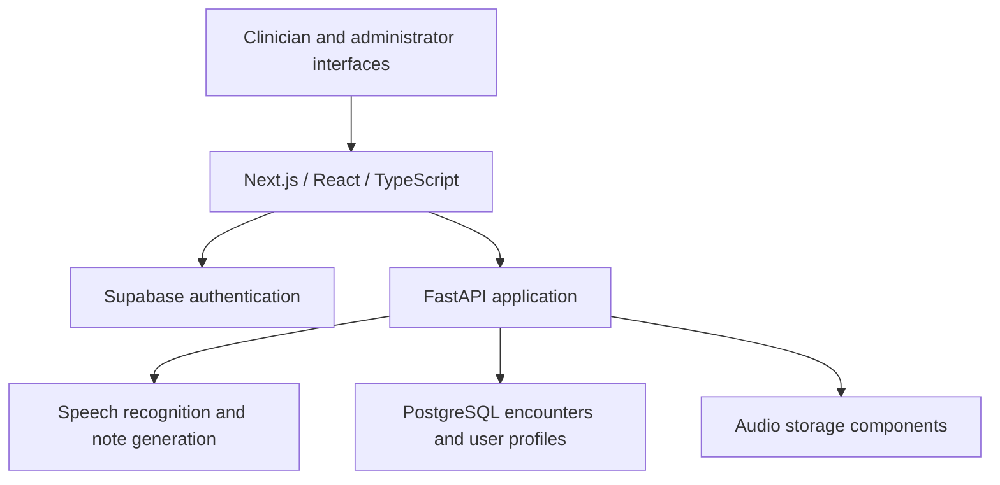

# AI Clinic Scribe — Case Study

### Turning consultation audio into structured clinical notes

I built an AI assisted medical scribe application for a confidential client, bringing consultation recording, transcription, editable clinical notes, and encounter management into one browser based workflow.

This case study explains the product problem, how the system addresses it, and the engineering work behind the application. The client implementation remains private under NDA.

**My work:** Full stack application development, AI integration, encounter workflows, and administrative tools.

**Stack:** Next.js · React · TypeScript · FastAPI · Python · OpenAI · Supabase · PostgreSQL

## The problem across clinic chains

A consultation creates information that must become a usable clinical record. When clinicians have to reconstruct that conversation and type notes manually, documentation competes with time spent on patient care.

For a clinic chain, the product challenge extends beyond an individual note: multiple clinicians need a consistent documentation workflow, while administrators need account management and visibility into encounter activity. A transcript alone does not solve that problem; the conversation still needs to become organized, editable information that can be saved and revisited.

AI Clinic Scribe addresses that workflow from recording through note review and encounter management.

## How the system addresses it

| Workflow challenge | What I built | Intended value |
| --- | --- | --- |
| Turning a spoken consultation into a written record | Browser recording and audio upload connected to AI transcription | Reduce the manual work of reconstructing a conversation |
| Organizing a transcript into useful clinical information | AI generation of five structured clinical fields | Give clinicians an organized first draft |
| Keeping clinicians in control of the record | Editable transcripts and clinical forms before saving | Let the clinician review and correct generated content |
| Returning to an earlier encounter | Saved encounter lists, detail views, editing, and dictation updates | Support follow-up documentation in the same workflow |
| Coordinating multiple clinician accounts | Administrative account tools and role aware dashboards | Give administrators a shared view of users and encounter activity |
| Helping clinicians focus on their own work | Doctor dashboards and ownership based encounter access | Present relevant records and activity for each clinician |

## A consultation through the system

1. **Capture:** The clinician records a consultation in the browser or uploads an audio file.
2. **Transcribe:** Speech recognition converts the audio into text.
3. **Review the transcript:** The clinician can correct the text before generating notes.
4. **Structure:** The AI organizes the transcript into chief complaint, history of present illness, medications, diagnosis, and treatment plan.
5. **Review and save:** The clinician edits the draft and saves an encounter.
6. **Revisit:** The clinician can open saved notes, edit them, or dictate an update. Administrators have broader encounter visibility and account tools.

## What I built

### Clinician workspace

- Browser audio recording and file upload.
- Transcription review and AI note generation.
- Editable clinical forms with consistent fields.
- Encounter lists, detail views, and note updates.
- Doctor dashboards showing encounter activity and status.
- Loading feedback, keyboard shortcuts, and light/dark themes.

### Administrative workspace

- Account creation, password reset, and deactivation controls.
- Administrative dashboards and encounter summaries by doctor.
- Doctor filters and access to encounter records across clinicians.
- Backend components for roles, permissions, and administrative audit logging.

### Backend and AI integration

- FastAPI endpoints connecting the interface, AI services, and database.
- Speech recognition and language model calls as separate workflow steps.
- Structured JSON mapped into typed clinical form fields.
- Supabase authentication and PostgreSQL encounter storage.
- Supporting private audio-storage and scheduled-cleanup components.

## Architecture

The backend coordinates requests and data access. AI services generate a draft; the interface turns that draft into an editable document workflow. This separation keeps the product centered on clinician review rather than treating a model response as a finished record.

[Read the workflow and engineering decisions →](docs/workflow.md)

## Why this work matters

The value of a scribe comes from connecting the steps around a consultation. Recording, transcription, structured drafting, review, saving, and later updates need to work together for the tool to fit a clinician's routine.

For clinic-chain teams, that same workflow also needs administrative visibility across clinicians. This project combines those clinician and administrator perspectives in one application, with the goal of reducing documentation effort and making encounter records easier to organize and revisit.

These benefits describe the product's intended value. Measured time savings, clinical accuracy results, and adoption figures are not published in this case study.

## Resume summary

> Built a full stack AI medical scribe for a confidential client using Next.js, FastAPI, OpenAI, and Supabase, combining consultation transcription, editable structured clinical notes, encounter management, and administrative dashboards.

**Portfolio link:** [AI Clinic Scribe Case Study](https://github.com/AhmadTariq-4090/ai-clinic-scribe-case-study)

## Confidentiality

This public repository contains the case study only. Client identity, application source code, prompts, production details, and patient information remain private. [Publication boundaries →](docs/publication-boundaries.md)
