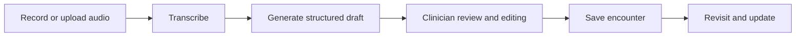

# AI Clinic Scribe

A public portfolio case study about building an AI assisted clinical documentation workflow for a confidential client project.

The central product idea is straightforward: turn a recorded consultation into an editable draft, give the clinician control over the final text, and make saved encounters easy to revisit.

> This repository contains an anonymized project narrative. The implementation is private under a client NDA. Client identity, production details, source code, model prompts, and patient information are not included.

## The problem

Clinical documentation adds work after a consultation. A useful assistant needs to help organize the conversation while keeping the clinician involved in reviewing and correcting the result.

The project explores a browser based workflow that brings recording, transcription, structured drafting, and encounter management into one interface.

## The workflow

1. A clinician signs in and records or uploads consultation audio.
2. Speech recognition produces a transcript.
3. An AI service organizes the transcript into clinical fields.
4. The clinician reviews and edits the draft.
5. The reviewed note is saved as an encounter and can be revisited.

## Engineering work

The implementation includes a React and Next.js interface, a Python and FastAPI backend, speech recognition and language model integration, and Supabase services for authentication and data storage.

The application contains editable clinical forms, encounter views, role aware dashboards, and administrative account management. The backend includes authentication checks, database access policies, administrative audit logging, and supporting audio storage and cleanup components.

These are descriptions of implementation scope. They do not establish that every workflow is production validated or that the system meets a regulatory standard.

## Design considerations

| Consideration | Engineering focus |
| --- | --- |
| Clinician control | Keep generated content editable before saving |
| Structured information | Map AI output into predictable form fields |
| Account separation | Apply authorization at the API and database layers |
| Temporary audio | Treat retention and deletion as explicit lifecycle concerns |
| Clear feedback | Show progress, errors, and saved encounter status |
| Confidentiality | Keep the client implementation and operational details private |

## Lessons and tradeoffs

An AI integration is only one part of the product. Authentication, data ownership, recovery from failed processing, retention, and a reliable review experience need equal attention.

Structured JSON helps connect model output to forms, but it does not prove the clinical accuracy of the content. A reviewable draft and a clear human approval step remain essential design considerations.

Separating temporary audio from saved notes also introduces lifecycle questions: uploads can fail, recordings can become orphaned, and deletion jobs need verification. Retention should be tested across these cases rather than inferred from the existence of a scheduled job.

## Evidence and boundaries

This case study describes the problem, workflow, and broad engineering work. It does not publish measured time savings, clinical accuracy scores, adoption figures, or deployment certification. No public demo is provided because the client application is confidential.

See [the workflow discussion](docs/workflow.md) for more on product decisions and [the publication boundaries](docs/publication-boundaries.md) for what this repository intentionally omits.

## Repository scope

This is a documentation repository, not an installable application or an open source release of the client project. No rights to the private implementation are granted by this case study.
